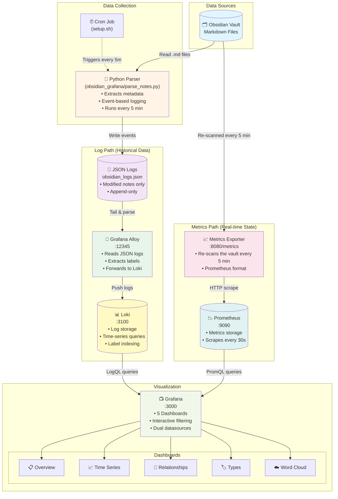

# Obsidian to Grafana Monitoring System

A comprehensive monitoring and analytics system for Obsidian vaults. Transform your Markdown notes into time-series metrics and interactive dashboards using industry-standard observability tools (Loki, Prometheus, Grafana, Alloy).

**What it does:**
- 📊 Tracks note statistics (word count, line count, file size) over time
- 🏷️ Analyzes tags, frontmatter fields, and metadata patterns
- 🔗 Visualizes note relationships through wikilinks
- 📈 Provides current-state metrics (refreshed every few minutes) and historical trend analysis
- ⚡ Uses event-based logging to efficiently track only modified notes

**Why it's useful:**
- Understand your writing habits and vault growth patterns
- Monitor content organization and tagging consistency
- Identify highly connected notes and knowledge clusters
- Track progress on notes with specific frontmatter (status, priority, etc.)
- Gain insights into your personal knowledge management system

## Architecture

This system uses a dual-path architecture for comprehensive monitoring:



### Data Flow

**Path 1: Log-Based (Event Tracking)**
1. **Python Parser** extracts metadata from all `.md` files in the Obsidian vault
2. Parser checks last run timestamp and only processes **modified notes** (event-based)
3. Structured JSON entries are **appended** to `obsidian_logs.json`
4. **Alloy** tails the log file, parses JSON, and extracts labels (vault, tags, frontmatter fields)
5. **Loki** stores log entries with labels for efficient querying
6. **Grafana** queries Loki using LogQL to display historical trends and relationships

**Path 2: Metrics-Based (Current State)**
1. **Metrics Exporter** service runs the parser in metrics-only mode (a separate container process, independent of the cron job)
2. It scans the entire vault, then **re-scans on an interval** (default 300 seconds, `metrics_refresh_interval` in `config.yaml` or `--refresh-interval`), replacing its metrics with the fresh snapshot so renamed, deleted and edited notes are reflected
3. Metrics are exposed via HTTP endpoint at `:8080/metrics`
4. **Prometheus** scrapes metrics every 30 seconds
5. **Grafana** queries Prometheus using PromQL for current-state statistics (at most one refresh interval behind your vault)

### Components

| Component | Purpose | Port | Technology |
|-----------|---------|------|------------|
| Python Parser | Metadata extraction and metrics generation | N/A | Python 3, frontmatter, PyYAML |
| Cron Job | Scheduled execution (every 5 minutes) | N/A | System cron |
| Alloy | Log collection and forwarding | 12345 | Grafana Alloy v1.21.3 |
| Loki | Log storage and querying | 3100 | Grafana Loki 3.7.9 (TSDB index, schema v13) |
| Prometheus | Metrics storage and TSDB | 9090 | Prometheus v3.15.1 |
| Metrics Exporter | Prometheus metrics endpoint | 8080 | Python + prometheus_client |
| Grafana | Visualization and dashboards | 3000 | Grafana 13.3.0 |
| Grafana plugins | Panels and AI assistant (installed on start) | — | grafana-assistant-app 2.0.96, marcusolsson-calendar-panel 4.2.4, volkovlabs-echarts-panel 7.2.5 |

All published ports are bound to `127.0.0.1` (this machine only). All image and plugin versions are pinned in `docker-compose.yml`.

**Key Features:**
- 🔄 **Event-Based Logging**: Only modified notes are logged, reducing storage by 90%+
- 📊 **Dual Data Sources**: Combines historical logs (Loki) with real-time metrics (Prometheus)
- 🏷️ **Label-Based Indexing**: Frontmatter fields become Loki labels for fast filtering
- 🐳 **Containerized**: All services run in Docker with Docker Compose
- ⚡ **Efficient**: Incremental parsing with timestamp tracking

## Features

### Data Collection
- **Basic Statistics**: Tracks word count, line count, character count, and file size for every note
- **Frontmatter Extraction**: Parses all YAML frontmatter fields (status, category, priority, type, etc.)
- **Tag Tracking**: Captures both frontmatter `tags` arrays and inline `#hashtags`
- **Wikilink Detection**: Identifies `[[note]]` references for relationship mapping
- **File Timestamps**: Records creation and modification times for each note
- **Event-Based Logging**: Only logs notes modified since last run, reducing storage and processing overhead

### Monitoring & Metrics
- **Prometheus Metrics**: Current-state metrics exposed via HTTP endpoint, refreshed on an interval
  - Total note count per vault
  - Total word count across all notes
  - Unique tag count
  - Total wikilink count
  - Per top-level folder: notes, words, wikilinks, unique tags (`obsidian_folder_*`)
  - Histograms of note length in words and of outgoing links per note
  - The top 50 most-linked notes by backlinks (`obsidian_top_linked_note_backlinks`)
  - Top 100 word frequencies (powers the Word Cloud dashboard)
  - No per-note series: per-note facts (word count, links, tags, frontmatter) come from the Loki note events
- **Automatic Log Rotation**: Rotates logs when they exceed 50MB to manage disk space
- **Scheduled Parsing**: Automated cron job runs every 5 minutes to capture changes

### Visualization
Five pre-configured Grafana dashboards:

1. **Overview Dashboard**: High-level vault statistics, processing rate, and recent activity
2. **Time Series Dashboard**: Individual note metrics tracked over time with filtering
3. **Relationships Dashboard**: Wikilink network analysis and backlink visualization
4. **Types Dashboard**: Distribution and patterns of frontmatter types (e.g., NPC, PC, audio)
5. **Word Cloud Dashboard**: The most frequent words across the vault (code blocks, URLs and common stopwords are filtered out)

**Interactive Filtering**: All dashboards support filtering by vault, tags, categories, note names, and frontmatter fields

### Technical Features
- **Containerized Deployment**: All services run in Docker with Docker Compose
- **YAML Configuration**: Simple config file for easy customization
- **Dual Data Paths**: Combines log-based event tracking with current-state metrics
- **Label-Based Indexing**: Frontmatter fields become Loki labels for efficient querying
- **Hidden File Exclusion**: Automatically skips hidden files and `.` directories

## Quick Start

### 1. Set Up Configuration

First, copy the example configuration file and customize it for your setup:

```bash
cp config.yaml.example config.yaml
```

Then edit `config.yaml` and update the values:

```yaml
vault_path: "/path/to/your/obsidian/vault"  # Update this to your actual vault path
output_file: "./logs/obsidian_logs.json"
log_level: "INFO"  # Options: DEBUG, INFO, WARNING, ERROR
metrics_port: 8080
start_metrics_server: false  # Set to true to enable metrics collection
grafana_password: "your_grafana_password_here"  # Choose a password; there is NO default
```

**Important**: The `config.yaml` file contains sensitive information (like your Grafana password) and is excluded from version control. Always use the `config.yaml.example` file as a template.

`config.yaml` (in the repository root) is the single place to set your vault path and Grafana password. `setup.sh` reads both values from it, exports them to Docker Compose, and mirrors them into a generated, git-ignored `.env` so plain `docker compose` commands (`down`, `logs`, `ps`) keep working. An `.env` you wrote yourself is never overwritten; if you run `docker compose` without `setup.sh`, copy `.env.example` to `.env` and set `VAULT_PATH` and `GRAFANA_PASSWORD` there. Compose refuses to start if either is missing.

### 2. Prerequisites

`setup.sh` checks for these and stops with a clear message if one is missing:

- Docker with the Compose v2 plugin (`docker compose`; the old `docker-compose` v1 binary is not supported)
- `python3` with the `venv` module (setup creates `.venv/` and installs `requirements.txt` into it; cron uses that virtualenv)
- `crontab`
- `jq` (only for the dashboard export hook and CI)

For development and tests: `pip install -r requirements-dev.txt`, then `python -m pytest`.

### 3. Start the System

Run the setup script to start everything:

```bash
./setup.sh
```

This will:
- Check dependencies, create `.venv/` and install the Python requirements
- Read the vault path and Grafana password from `config.yaml` (and refuse the placeholder or an empty password)
- Create `logs/` and start all Docker containers
- Install (or refresh) the cron jobs that run the parser and vault index every 5 minutes. Re-running `setup.sh` replaces its own entries instead of duplicating them, and also replaces entries from older versions of this script

Services available at (localhost only; nothing is published on your network):
- **Grafana** at http://localhost:3000 (user `admin`, password = `grafana_password` from `config.yaml`)
- **Loki** at http://localhost:3100
- **Alloy** at http://localhost:12345
- **Prometheus** at http://localhost:9090
- **Metrics Exporter** at http://localhost:8080

The parser will run every 5 minutes automatically.

### Grafana Assistant Plugin

The [Grafana Assistant](https://grafana.com/grafana/plugins/grafana-assistant-app/) plugin (`grafana-assistant-app` **2.0.96**) is installed automatically, like the two panel plugins, through `GF_PLUGINS_PREINSTALL_SYNC` in `docker-compose.yml`. The plugin is downloaded from grafana.com into the `grafana_data` volume the first time Grafana starts, so it survives container recreation (`docker compose up -d --force-recreate`, image updates). Nothing needs to be unzipped by hand and `grafana/plugins/` is no longer used.

Assistant 2.x requires **Grafana 13.1 or newer**, which is why Grafana is pinned to 13.3.0. To change a plugin version, edit the `@version` in `GF_PLUGINS_PREINSTALL_SYNC` and run `docker compose up -d grafana`. If you previously installed Assistant 1.x by unzipping it into the volume, the pinned version is installed over it on the next start; if Administration → Plugins still shows 1.x afterwards, remove the old copy (`docker run --rm -v obsidian-grafana_grafana_data:/data alpine rm -rf /data/plugins/grafana-assistant-app`, adjusting the volume prefix to your Compose project name) and start Grafana again. Grafana needs internet access to grafana.com the first time it starts with a new plugin version (a failed download stops startup); afterwards it starts offline.

### 4. Test the System

Run the parser manually to generate initial data:

```bash
.venv/bin/python -m obsidian_grafana.parse_notes
```

Check that logs are being generated:

```bash
tail -f ./logs/obsidian_logs.json
```

### 5. View Dashboards

Open Grafana at http://localhost:3000 and explore the pre-configured dashboards:

- **Obsidian Overview**: High-level vault statistics and recent activity
- **Time Series**: Word count, line count, and file size trends over time
- **Note Relationships**: Wikilinks and backlink analysis
- **Frontmatter Types**: Distribution and usage patterns of different frontmatter types
- **Word Cloud**: Most frequent words in the vault

## Saving Dashboard Changes

Dashboards are provisioned from JSON files in `grafana/dashboards/`. If you edit a dashboard in the Grafana UI, those changes are saved only to Grafana's internal database — **not** back to the JSON files. This means UI changes won't be included when you `git push`.

To solve this, a pre-commit hook automatically exports the latest dashboard JSON from Grafana before each commit.

### Setup (one-time)

Configure git to use the project's hooks directory:

```bash
git config core.hooksPath hooks
```

This requires `jq` to be installed:

```bash
brew install jq        # macOS
sudo apt install jq    # Debian/Ubuntu
```

### How it works

1. You edit dashboards in the Grafana UI as normal
2. When you `git commit`, the pre-commit hook checks if Grafana is running
3. If running, it exports all dashboards via the API and overwrites the JSON files in `grafana/dashboards/`
4. Any changes are automatically staged into the commit
5. If Grafana isn't running, the hook silently skips (so commits still work offline)

### Manual export

You can also export dashboards manually at any time:

```bash
./scripts/export-dashboards.sh
```

The script accepts environment variables for non-default setups:

| Variable | Default | Description |
|---|---|---|
| `GRAFANA_URL` | `http://localhost:3000` | Grafana base URL |
| `GRAFANA_USER` | `admin` | API username |
| `GRAFANA_PASSWORD` | `grafana_password` from `config.yaml` | API password (required; there is no default) |

## Manual Usage

### Run Parser Manually

```bash
# Using config file (use the virtualenv that setup.sh created, or any environment with requirements.txt installed)
.venv/bin/python -m obsidian_grafana.parse_notes

# Override vault path
.venv/bin/python -m obsidian_grafana.parse_notes --vault-path /path/to/vault

# Override output file
.venv/bin/python -m obsidian_grafana.parse_notes --output /tmp/custom_logs.json

# Set log level (command line > config.yaml > INFO)
.venv/bin/python -m obsidian_grafana.parse_notes --log-level DEBUG
```

Command-line options override `config.yaml`, which overrides the built-in defaults (`log_level: INFO`, `metrics_port: 8080`, `output_file: ./logs/obsidian_logs.json`).

### View Alloy Status

Visit http://localhost:12345 to see Alloy's status and configuration.

## Breaking change: per-note metrics removed

The exporter no longer emits `obsidian_note_total`, `obsidian_word_count_total`, `obsidian_tags_total` and `obsidian_note_wikilinks` (labelled `note_name` and `file_path`, about 6 series per note). They are not behind a flag, so the local stack and Grafana Cloud see the same low-series metrics. Anything you queried from them has a replacement:

| Before | Now |
| --- | --- |
| `count(obsidian_note_wikilinks == 0)` (orphans) | `sum(obsidian_note_outlinks_bucket{le="0.0"})` |
| `count(obsidian_note_wikilinks == N)` (distribution) | differences of `obsidian_note_outlinks_bucket` (le 0, 1, 2, 5, 10, +Inf) |
| `topk(N, obsidian_note_wikilinks)` (outgoing links per note) | `topk(N, obsidian_top_linked_note_backlinks)` (backlinks, top 50) |
| list of orphan notes | LogQL on note events: `{job="obsidian-parser"} \| json \| line_format "{{.line}}" \| json \| wikilinks = ""` |
| per-note word count | LogQL: `last_over_time({job="obsidian-parser"} \| json \| line_format "{{.line}}" \| json \| unwrap word_count [7d]) by (note_name)` for a few notes (add a `note_name="..."` filter; Loki limits the series per query) |

New `wikilink_count` field on each note event (numeric). Old Prometheus data for the removed series stays in local Prometheus until retention expires.

## Dashboard Queries

The dashboards provisioned from `grafana/dashboards/` use LogQL (Loki) for event history and PromQL (Prometheus) for current state. They reference their datasources by the fixed uids `loki` and `prometheus`, which `grafana/provisioning/datasources/` pins, so they work on any fresh install. Representative queries (copy them into **Explore** to experiment):

```logql
# Notes created / modified in the last hour (Overview)
sum(count_over_time({job="obsidian-parser", event_type="created"}[1h]))
sum(count_over_time({job="obsidian-parser", event_type="modified"}[1h]))

# Recently updated notes: each log line is the full entry, whose "line" field holds the note metadata
{job="obsidian-parser"} | json | line_format "{{.line}}" | json | modified_at != ""

# Frontmatter type distribution (Types); frontmatter_* are also Loki labels
sum by (frontmatter_type) (count_over_time({job="obsidian-parser"} | json | frontmatter_type != "" [7d]))
sum by (frontmatter_type, vault) (count_over_time({job="obsidian-parser"} | json | frontmatter_type != "" [7d]))

# Notes containing wikilinks (Relationships)
count_over_time({job="obsidian-parser"} |= "wikilinks" [$__range])
```

```promql
# Current-state metrics from the exporter (Overview, Word Cloud)
obsidian_notes_count
obsidian_words_total
obsidian_wikilinks_total / obsidian_notes_count   # links per note
sum(obsidian_note_outlinks_bucket{le="0.0"})      # notes without outgoing links (histogram bucket)
topk(10, obsidian_top_linked_note_backlinks)      # most linked notes
sum by (folder) (obsidian_folder_notes)           # notes per top-level folder
histogram_quantile(0.5, sum by (le) (obsidian_note_length_words_bucket))  # median note length
topk(100, obsidian_word_frequency)                # word cloud
```

Known limitation: the Time Series dashboard's queries (`| json | unwrap word_count`) expect the note metadata at the top level of the log line, but the log line stores it inside the entry's `line` field (as the Overview queries above assume), so those four panels currently show no data.

## Configuration

### Python Parser (`obsidian_grafana/parse_notes.py`)

The parser extracts comprehensive metadata from each note:

**Extracted Fields:**
- **Basic Stats**: `word_count`, `line_count`, `char_count`, `file_size`
- **Timestamps**: `created_at`, `modified_at` (with internal timestamp tracking for event-based logging)
- **Frontmatter**: All YAML frontmatter fields exported as `frontmatter_*` labels
  - Supports strings, numbers, booleans, and lists (lists are comma-separated)
  - Common fields: `frontmatter_status`, `frontmatter_category`, `frontmatter_priority`, `frontmatter_type`
- **Tags**: 
  - `tags`: Frontmatter tags (from YAML array)
  - `inline_tags`: Inline `#hashtags` extracted via regex
- **Wikilinks**: `[[note]]` references parsed and stored for relationship analysis (`wikilinks`: comma-joined targets, `wikilink_count`: numeric, usable with LogQL `unwrap`)
- **File Info**: `note_name`, `file_path` (relative to vault root)

**Event-Based Logging:**
- Tracks last run timestamp in `.last_run` file
- Only processes notes modified since last run
- Reduces log volume and processing time for large vaults

**Configuration Options:**
```yaml
vault_path: "/path/to/vault"        # Required: Path to Obsidian vault
output_file: "./logs/obsidian_logs.json"  # Where to write log entries
log_level: "INFO"                   # DEBUG, INFO, WARNING, ERROR
metrics_port: 8080                  # Prometheus metrics endpoint port
metrics_refresh_interval: 300       # Seconds between vault re-scans in the metrics exporter
start_metrics_server: false         # Enable/disable metrics server
top_linked_notes: 50                # Most-linked notes exposed as a metric (0 disables)
max_folders: 50                     # Top-level folders exposed individually; the rest become "(other)"
grafana_password: "choose-one"      # Grafana admin password (required, no default)
index_output_path: "/path/to/index" # Where export_vault_index.py writes (OpenClaw integration)

# Files to exclude from parsing (matched against note filename without extension)
exclude_files:
  - "Changelog"
```

The `exclude_files` list skips notes by filename (without `.md` extension). Use this for extremely large notes that exceed Loki's `max_line_size` or that don't need monitoring.

### Alloy Configuration

Alloy serves as the log collector and forwarder:

**Monitored Files:**
- `obsidian_logs.json`: Structured JSON log entries from parser
- `obsidian_parser.log`: Parser execution logs (for debugging). Alloy ships only this file's JSON lines (the cron heartbeat, `job="obsidian-cron"`); the parser's plain-text output (warnings, INFO lines) stays in the file and is not sent to Loki. `scripts/cron-parse.sh` rotates it by size: above 10 MiB (`OBSIDIAN_PARSER_LOG_MAX_BYTES`) it is moved aside and gzipped, keeping 3 generations (`OBSIDIAN_PARSER_LOG_KEEP`) as `obsidian_parser.log.1.gz` to `.3.gz`, and Alloy picks up the fresh file automatically.

**Processing Pipeline:**
1. Discovers the files with `local.file_match` (so files that don't exist yet at startup are picked up once they appear) and reads them via `loki.source.file` (positions persisted in `alloy_data` volume)
2. Parses JSON and extracts labels via `loki.process`
3. Parses the entry timestamp using RFC3339Nano format (preserves original event time)
4. Converts frontmatter fields to Loki labels (vault, job, tags, frontmatter_*)
5. Forwards to Loki via `loki.write`

**Label Extraction:**
- `vault`: Vault name (from vault path)
- `job`: `obsidian-parser` for `obsidian_logs.json` entries; `obsidian-cron` for lines from `obsidian_parser.log`
- `tags`: Comma-separated frontmatter tags
- `frontmatter_*`: All frontmatter fields as individual labels

### Grafana Dashboards

Five pre-configured dashboards are automatically provisioned:

1. **Overview (`overview.json`)**: 
   - Total notes count
   - Processing rate and throughput
   - Recent activity timeline
   - Vault-level statistics

2. **Time Series (`timeseries.json`)**: 
   - Individual note metrics over time
   - Word count, line count, file size trends
   - Filtering by note name, tags, categories

3. **Relationships (`relationships.json`)**: 
   - Wikilink network visualization
   - Backlink analysis
   - Note connection patterns

4. **Frontmatter Types (`types.json`)**: 
   - Distribution of frontmatter types (NPC, PC, audio, etc.)
   - Type usage patterns over time
   - Pie charts and time series by type

5. **Word Cloud (`wordcloud.json`)**:
   - Top words across the vault (`obsidian_word_frequency` from Prometheus)
   - Uses the `volkovlabs-echarts-panel` plugin

**Data Sources:**
- **Loki**: For log-based queries and event tracking
- **Prometheus**: For real-time metrics and current state

## Grafana Cloud forwarding (optional)

Off by default. When enabled, the same data the local dashboards use is also sent to your Grafana Cloud stack, so Cloud works as a backup and every dashboard works there. Local storage (Loki, Prometheus) and the local dashboards are unchanged.

**What is sent (read this first).** Logs, full detail: note titles, relative file paths (so folder names), tags, all frontmatter keys and values, wikilink targets. Metrics, a few hundred series only: vault totals, per-top-level-folder totals (so folder names), note length and outgoing-link histograms, the titles of the 50 most-linked notes, and the `obsidian_word_frequency` metric (the vault's top 100 body words). No note body text, excerpts or headings are sent. **Not sent:** the parser's own log (`logs/obsidian_parser.log`, `job=obsidian-cron`), which can contain absolute vault paths and stays local.

**How it works.** A second Alloy container, `alloy-cloud` (compose profile `cloud`, config in `alloy/cloud.alloy`), tails `logs/obsidian_logs.json` into Grafana Cloud Loki with the same label extraction as the local pipeline, and scrapes the exporter's `/metrics` and remote-writes them to Grafana Cloud Metrics. It has its own read positions (`alloy_cloud_data` volume), so on first start it replays the whole existing log file; Grafana Cloud rejects log lines older than its ingestion window (about a week by default), so older history only reaches Cloud if you ingest it some other way.

**Enable it.**

1. In Grafana Cloud, create an access policy token with the `metrics:write` and `logs:write` scopes.
2. Add to `.env` (see `.env.example`; the Prometheus and Loki URLs and user IDs are on your stack's Details page):

   ```bash
   GRAFANA_CLOUD_PROMETHEUS_URL="https://prometheus-prod-XX-prod-REGION.grafana.net/api/prom/push"
   GRAFANA_CLOUD_PROMETHEUS_USER="123456"
   GRAFANA_CLOUD_LOKI_URL="https://logs-prod-XXX.grafana.net/loki/api/v1/push"
   GRAFANA_CLOUD_LOKI_USER="123456"
   GRAFANA_CLOUD_TOKEN="glc_..."
   ```

3. Start it: `docker compose --profile cloud up -d` (plain `docker compose up -d` keeps working without these variables and never starts `alloy-cloud`). If a variable is missing, `docker compose logs alloy-cloud` shows which one. To stop forwarding, run `docker compose stop alloy-cloud` (or leave the profile off).

`.env` is gitignored; never commit the token. Note that `setup.sh` runs a plain `docker compose up -d`, so re-run the `--profile cloud` command after it (or set `COMPOSE_PROFILES=cloud` in `.env`).

**Metric cardinality.** Grafana Cloud bills per active series, so the exporter exposes no series per note. Series count is bounded regardless of vault size: 4 vault totals + 4 per top-level folder (at most 51 folders, extra ones are folded into `(other)`, so at most 204) + 12 note-length histogram + 8 outgoing-links histogram + at most 50 most-linked notes + at most 100 words + `up`, about 380 at the very most, and typically 200 to 300. `alloy/cloud.alloy` additionally forwards only an allowlist of these metric names and drops any series that carries a `file_path` label, so a per-note series can never reach Cloud even if one is added to the exporter. Tune with `top_linked_notes` (0 disables) and `max_folders` in `config.yaml`, or `--top-linked-notes` / `--max-folders`. Check what Cloud holds with `count({job="obsidian-metrics"})` (active series; also `count by (__name__) ({job="obsidian-metrics"})`).

**Dashboards in Grafana Cloud.** Cloud's built-in datasources have different uids from the local ones (`grafanacloud-logs` and `grafanacloud-prom` instead of `loki` and `prometheus`). `scripts/import-cloud-dashboards.sh` rewrites those references on the fly and imports all five dashboards through the Grafana API, without touching the files in `grafana/dashboards/`:

```bash
export GRAFANA_CLOUD_STACK_URL="https://yourstack.grafana.net"
export GRAFANA_CLOUD_API_TOKEN="glsa_..."   # service account token with the Editor role (not the write token above)
scripts/import-cloud-dashboards.sh           # --dry-run DIR writes the rewritten JSON to DIR instead
```

Install the `volkovlabs-echarts-panel` and `marcusolsson-calendar-panel` plugins in your Cloud stack first (the Word Cloud and Timeseries dashboards need them). Set `CLOUD_LOKI_UID` / `CLOUD_PROMETHEUS_UID` if your datasource uids differ. Note that the exporter runs in a container, so in Cloud the metrics carry `vault="vault"` (the mount name), exactly as in the local Prometheus.

**Removing data from Cloud.** Metrics series expire on their own after you stop sending. Logs can be deleted by a Grafana Cloud admin on request, or left to expire with your stack's log retention.

## Troubleshooting

### Parser Issues

```bash
# Check parser logs
tail -f ./logs/obsidian_parser.log

# Run with debug logging
.venv/bin/python -m obsidian_grafana.parse_notes --log-level DEBUG

# Verify JSON logs are being created
tail -f ./logs/obsidian_logs.json

# Check last run timestamp
cat ./logs/.last_run
```

**Common Issues:**
- **"Vault path does not exist"**: Ensure `vault_path` in `config.yaml` is correct
- **No logs generated**: Check file permissions on the `logs/` directory (it is created by `setup.sh`, and tracked via `logs/.gitkeep`; if Docker created it first it may be owned by root)
- **Frontmatter not parsing**: Ensure YAML frontmatter is valid and uses `---` delimiters

### Docker Issues

```bash
# Check container status
docker compose ps

# View all logs
docker compose logs -f

# View specific service logs
docker compose logs -f grafana
docker compose logs -f loki
docker compose logs -f alloy
docker compose logs -f metrics-exporter

# Restart specific service
docker compose restart grafana

# Restart all services
docker compose restart

# Rebuild after code changes
docker compose up -d --build
```

### Alloy Issues

- Visit http://localhost:12345 for Alloy UI and status
- Check that `./logs/obsidian_logs.json` is being created and populated
- Verify Loki connectivity in Alloy logs: `docker compose logs alloy`
- Ensure log files are mounted correctly in the container
- Alloy stores file read positions in the `alloy_data` Docker volume — if this is lost, Alloy re-reads files from the beginning, which may cause duplicate entries in Loki

### Loki Issues

```bash
# Check Loki is receiving logs
curl http://localhost:3100/ready

# Query Loki directly
curl -G http://localhost:3100/loki/api/v1/query \
  --data-urlencode 'query={job="obsidian-parser"}' \
  --data-urlencode 'limit=10'
```

### Prometheus Issues

- Visit http://localhost:9090 to access Prometheus UI
- Check targets at http://localhost:9090/targets to ensure metrics-exporter is UP
- Verify metrics endpoint: `curl http://localhost:8080/metrics`

### Grafana Issues

- **Datasources**: Check configuration at http://localhost:3000/datasources
- **No data in dashboards**: 
  - Verify Loki has data: use Explore view with query `{job="obsidian-parser"}`
  - Check time range in dashboard (default is last 6 hours)
  - Ensure parser has run at least once
- **Authentication issues**: Log in as `admin` with `grafana_password` from `config.yaml`. Grafana only reads the admin password when its database is first created, so changing it in `config.yaml` later does not change an existing install; change it in the Grafana UI (profile → Change password). There is no default password.

## Backfill and Re-ingestion

> **Legacy tool.** `scripts/legacy/backfill_event_type.py` was a one-time migration for logs written before `event_type` existed. New installs don't need it. It is kept (with its tests) for anyone still holding old logs.

If you need to backfill `event_type` (created/modified) to existing log entries or re-ingest data into Loki, follow these steps.

### Prerequisites

The backfill script adds `event_type` labels to distinguish between newly created notes and modified notes:
- **created**: First time a note appears in the logs
- **modified**: Subsequent appearances of the same note

### Backfill Process

**Important**: The cron job runs every 5 minutes on the host. It must be paused during backfill and re-ingestion to prevent duplicates or corruption.

```bash
# 1. Stop the cron job
crontab -l > /tmp/cron_backup && crontab -r

# 2. Run the backfill script (creates backup automatically)
python3 scripts/legacy/backfill_event_type.py

# Or do a dry run first to see what would change
python3 scripts/legacy/backfill_event_type.py --dry-run

# 3. Verify the backfill succeeded
head -5 ./logs/obsidian_logs.json  # Check sample entries have event_type
wc -l ./logs/obsidian_logs.json    # Verify entry count

# 4. Stop all containers
docker compose down

# 5. Remove Loki and Alloy data volumes (this clears all stored logs)
docker volume rm obsidian-grafana_loki_data obsidian-grafana_alloy_data

# 6. Restart containers (Alloy will re-read the entire log file)
docker compose up -d

# 7. Restore the cron job
crontab /tmp/cron_backup
```

### Rollback

If something goes wrong:

```bash
# Restore the backup log file
cp ./logs/obsidian_logs.json.pre_backfill ./logs/obsidian_logs.json

# Clear volumes and restart (same as steps 4-6 above)
docker compose down
docker volume rm obsidian-grafana_loki_data obsidian-grafana_alloy_data
docker compose up -d

# Restore cron job
crontab /tmp/cron_backup
```

### What the Backfill Script Does

1. **Creates a backup**: `obsidian_logs.json` → `obsidian_logs.json.pre_backfill`
2. **Processes rotated files**: Finds all `obsidian_logs.json.*` files (excluding `.pre_backfill`), sorts chronologically
3. **Adds event_type**: First occurrence of each `file_path` = "created", subsequent = "modified"
4. **Generates state file**: Creates `.known_files` for the parser to use going forward
5. **Validates output**: Checks entry count and JSON validity before replacing the original

## File Structure

```
obsidian-grafana/
├── obsidian_grafana/                   # Python package
│   ├── parse_notes.py                  # Parser + Prometheus metrics exporter
│   └── export_vault_index.py           # OpenClaw vault index generator
├── tests/                              # pytest suite (event_type, vault index, word frequency, exporter)
│   ├── test_event_type.py
│   ├── test_exporter.py
│   ├── test_vault_index.py
│   └── test_word_frequency.py
├── pyproject.toml                      # pytest configuration
├── requirements.txt                    # Runtime Python dependencies (pinned)
├── requirements-dev.txt                # Adds pytest and pyflakes
├── config.yaml                         # User configuration (git-ignored)
├── config.yaml.example                 # Configuration template
├── .env.example                        # Docker Compose variables (setup.sh generates .env from config.yaml)
├── setup.sh                            # Setup script (venv + Docker + cron)
├── docker-compose.yml                  # Docker stack orchestration (pinned versions, localhost ports)
├── Dockerfile                          # Image for the metrics exporter service
├── .dockerignore
├── README.md                           # Documentation (this file)
├── .github/workflows/ci.yml            # CI: pyflakes, pytest, dashboard JSON + compose validation
│
├── scripts/
│   ├── cron-parse.sh                   # Cron entry point for the parser (+ heartbeat log line)
│   ├── cron-index.sh                   # Cron entry point for the vault index
│   ├── export-dashboards.sh            # Export Grafana dashboards to JSON files
│   └── legacy/
│       └── backfill_event_type.py      # One-time migration: adds event_type to existing logs
├── hooks/
│   └── pre-commit                      # Auto-exports dashboards before commits
│
├── alloy/
│   └── config.alloy                    # Alloy log collection configuration
│
├── grafana/
│   ├── provisioning/
│   │   ├── dashboards/
│   │   │   └── dashboards.yml          # Dashboard provisioning config
│   │   └── datasources/
│   │       ├── loki.yml                # Loki datasource (uid: loki)
│   │       └── prometheus.yml          # Prometheus datasource (uid: prometheus)
│   └── dashboards/
│       ├── overview.json               # Overview dashboard
│       ├── timeseries.json             # Time series dashboard
│       ├── relationships.json          # Relationships dashboard
│       ├── types.json                  # Frontmatter types dashboard
│       └── wordcloud.json              # Word cloud dashboard
│
├── logs/                               # Generated logs directory (contents git-ignored)
│   ├── .gitkeep                        # Keeps the folder in git so Docker doesn't create it as root
│   ├── obsidian_logs.json              # Structured log entries (appended)
│   ├── obsidian_parser.log             # Parser execution logs + cron heartbeat
│   ├── .last_run                       # Last run timestamp for event-based logging
│   └── .known_files                    # Known file paths for event_type tracking
│
├── loki-config.yaml                    # Loki storage and limits configuration
└── prometheus.yml                      # Prometheus scrape configuration
```

**Generated Files:**
- `logs/obsidian_logs.json`: Append-only log file with note metadata
- `logs/obsidian_parser.log`: Parser execution logs (from cron)
- `logs/.last_run`: Timestamp of last successful parser run
- `.venv/`: Virtualenv created by `setup.sh` (used by cron)
- `.env`: Generated by `setup.sh` from `config.yaml` (git-ignored)

**Docker Volumes:**
- `loki_data`: Loki log storage and indexes
- `grafana_data`: Grafana dashboards, preferences, and plugins
- `alloy_data`: Alloy's file read positions (tracks ingestion progress)
- `prometheus_data`: Prometheus metrics storage

## Upgrading from an earlier version

If you already have a running stack from before the pinned versions, back up the data volumes first, then pull and re-run setup:

```bash
# 1. Back up every data volume (adjust the prefix to your Compose project name; see `docker volume ls`)
docker compose stop
mkdir -p ~/obsidian-grafana-backup
for v in loki_data grafana_data alloy_data alloy_cloud_data prometheus_data; do
  docker volume inspect obsidian-grafana_$v >/dev/null 2>&1 || continue
  docker run --rm -v obsidian-grafana_$v:/data:ro -v ~/obsidian-grafana-backup:/backup alpine \
    tar czf /backup/$v.tgz -C /data .
done
# 2. Fetch the new version
git pull
# 3. Edit loki-config.yaml (see below) BEFORE continuing
# 4. Upgrade
docker compose pull && ./setup.sh
```

**Step 3, only if your install was running the older `boltdb-shipper`/`v11`-only Loki config:** after `git pull`, open `loki-config.yaml` and change the `from:` of the `tsdb`/`v13` period to a date in the future (for example the day after tomorrow). Do not edit or remove the existing `boltdb-shipper`/`v11` period. The shipped date, `2026-11-04`, is already in the past, so skipping this makes Loki 3.7.9 treat chunks written under v11 since that date as TSDB data, and queries will not find them. Do this edit after `git pull` (not before) so the pull does not conflict with it.

To roll back, `git checkout` the previous version, restore the volumes (`tar xzf` the archives back into emptied volumes) and run `docker compose up -d`. Everything is pinned in `docker-compose.yml` (images), `GF_PLUGINS_PREINSTALL_SYNC` (Grafana plugins), `Dockerfile` (Python base image) and `requirements.txt`; upgrade by editing a version deliberately, never by pulling `latest`. Things to know:

- **Loki 3.0.0 → 3.7.9, and the index format.** `loki-config.yaml` now has a second `schema_config` period (`store: tsdb`, `schema: v13`) that takes effect at 00:00 UTC on its `from:` date (`2026-11-04`). The original `boltdb-shipper`/`v11` period is kept; Loki never rewrites old data. For an existing install, follow step 3 above. Any period you add later needs a `from:` date in the future. On a brand-new install you may leave the date as is, or set it to any past date, to use TSDB from the start.
- **Grafana → 13.3.0** (from `latest`) and **Grafana Assistant → 2.0.96** (from the manually unzipped 1.1.52). Plugins are now installed through `GF_PLUGINS_PREINSTALL_SYNC` (see above).
- **Prometheus → v3.15.1, Alloy → v1.21.3.** The Prometheus console flags that no longer exist were removed.
- **Ports are bound to 127.0.0.1.** To reach the stack from another machine, put a reverse proxy in front of it rather than changing the bindings.
- **No default Grafana password.** `GRAFANA_PASSWORD` must be set (`setup.sh` does it from `config.yaml`). An existing Grafana volume keeps the password it was created with.
- **Loki usage reporting is disabled** (`analytics.reporting_enabled: false`); the stack no longer sends anonymous usage statistics to Grafana Labs.
- **Python code moved into the `obsidian_grafana` package.** Re-run `./setup.sh` so cron uses the new wrapper scripts and the virtualenv; the old cron entries are replaced. The exporter image now contains the code, so use `docker compose up -d --build` after code changes.
- **Dashboards use fixed datasource uids** (`loki`, `prometheus`). The datasource provisioning files first delete any existing datasource of the same name (`deleteDatasources`), then recreate it with the pinned uid; without that, Grafana refuses to start on a volume whose datasources were created with random uids. Installs that were using the old random uids are therefore migrated automatically on the next start.

## Production Considerations

This setup is optimized for personal use and local development. For production or multi-user deployments, consider:

### Security
- Set a strong `grafana_password` (there is no default). All published ports are already bound to `127.0.0.1`
- Enable HTTPS/TLS for all web interfaces (Grafana, Prometheus, Alloy)
- Use Docker secrets instead of plain-text config files for credentials
- Implement authentication for Prometheus and Loki endpoints
- Restrict network access using firewall rules or Docker network policies

### Performance & Scaling
- **Event-Based Logging**: Already implemented to reduce log volume
- **Log Rotation**: Automatic rotation at 50MB; adjust `max_file_size` in parser if needed
- **Loki Retention**: Configure retention policies in `loki-config.yaml` for long-term storage
- **Prometheus Retention**: Add `--storage.tsdb.retention.time` to the Prometheus command in `docker-compose.yml`
- **Parser Schedule**: Adjust cron frequency based on vault size and update frequency
- **Label Cardinality**: Monitor Loki label cardinality; reduce frontmatter labels if needed

### Data Persistence
- Four Docker volumes persist data across container restarts:
  - `loki_data`: All log data stored in Loki
  - `grafana_data`: Dashboards, preferences, and plugin data
  - `alloy_data`: Alloy's file read positions (tracks where it left off in log files)
  - `prometheus_data`: Prometheus metrics storage
- Back up these volumes regularly: `docker run --rm -v loki_data:/data -v $(pwd):/backup ubuntu tar czf /backup/loki_data_backup.tar.gz -C /data .`
- Consider external storage (NFS, S3) for long-term archival
- **Do not use `docker compose down -v`** unless you intend to reset everything — the `-v` flag deletes all volumes, including Alloy's positions and Loki's stored data

### Downtime & Data Gaps

The cron-based parser runs on the host and continues writing to `obsidian_logs.json` even when Docker is down. When Alloy restarts, it resumes from its saved position in the file and sends any missed entries to Loki.

**Requirements for seamless recovery:**
- The `alloy_data` volume must survive the restart (avoid `docker compose down -v`)
- Entries must not be older than `reject_old_samples_max_age` (currently 17520h / 730 days) in `loki-config.yaml`

**If Docker is down for longer than 730 days**, Loki will reject the oldest entries. To recover:

1. Stop Loki and Alloy: `docker compose stop loki alloy`
2. Remove their containers and volumes: `docker compose rm -f loki alloy && docker volume rm obsidian-grafana_loki_data obsidian-grafana_alloy_data`
3. Temporarily increase `reject_old_samples_max_age` and add `max_chunk_age` in `loki-config.yaml`:
   ```yaml
   ingester:
     max_chunk_age: 87600h
     chunk_idle_period: 87600h
   limits_config:
     reject_old_samples_max_age: 87600h
   ```
4. Start fresh: `docker compose up -d loki && sleep 5 && docker compose up -d alloy`
5. Wait for Alloy to finish re-ingesting (check `docker compose logs alloy` for errors)
6. Revert `loki-config.yaml` to normal values and restart Loki: `docker compose restart loki`

**Why 17520h (two years)?** `max_chunk_age` and `reject_old_samples_max_age` default here to 17520h so that up to two years of vault history can be restored or replayed (for example when re-ingesting an old `obsidian_logs.json`) without Loki rejecting entries as too old or flushing them in odd chunks. Trade-offs: Loki accepts writes up to two years in the past, so a badly timestamped entry will no longer be rejected as "too old" until it is older than that, and ingester chunks may stay in memory longer before being flushed. Be careful when lowering these values on a running install: reverting and restarting Loki before the WAL has been replayed can cause old entries in the WAL to be dropped, so avoid restarting Loki casually after a large replay.

### Monitoring & Reliability
- Add health checks to `docker-compose.yml` for all services
- Configure Grafana alerting for parser failures or data gaps
- Monitor disk space for log files and Docker volumes
- Set up log aggregation for cron job failures

### Multi-Vault Support
- Parser already supports multiple vaults via `vault` label
- Run separate parser instances with different `config.yaml` files
- All vaults can share the same Loki/Grafana infrastructure

## OpenClaw Integration

This system can feed an [OpenClaw](https://docs.openclaw.ai) agent with structured vault data so it can answer questions like "What should I work on next?" or "Which notes are linked to but not fleshed out?"

### How It Works

The `obsidian_grafana/export_vault_index.py` script scans the vault and produces two Markdown files:

- **`vault_index_summary.md`** (~500 lines): Top 50 most-backlinked notes, top 50 underdeveloped notes, recent modifications, and vault breakdown by status/type/folder/tags. Fits in an LLM context window.
- **`vault_index_full.md`** (all notes): Per-note metadata block for every note in the vault, sorted by backlink count. Searchable via `memory_search`.

OpenClaw does all the reasoning — the index provides raw structural data only (backlinks, word counts, tags, headings, etc.), not precomputed recommendations.

### Per-Note Metadata

Each note block in the index includes:

- Note name, relative path, word count
- Backlink count and list (which notes link TO this note)
- Outbound wikilinks list
- Tags (frontmatter + inline)
- Frontmatter fields (status, type, category, etc.)
- Aliases
- Creation and modification dates
- Heading outline (H1-H3)
- External URL count

### Running the Index Generator

```bash
# Using config.yaml (reads vault_path and index_output_path)
.venv/bin/python -m obsidian_grafana.export_vault_index

# Override vault path
.venv/bin/python -m obsidian_grafana.export_vault_index --vault-path /path/to/vault

# Override output directory
.venv/bin/python -m obsidian_grafana.export_vault_index --output-dir /path/to/syncthing/folder

# Debug logging
.venv/bin/python -m obsidian_grafana.export_vault_index --log-level DEBUG
```

The index runs automatically every 5 minutes via the cron job set up by `setup.sh`.

### Syncthing Setup

[Syncthing](https://syncthing.net/) syncs the vault and index files to the OpenClaw VM. The index files are kept **outside** the vault (to avoid Obsidian trying to index them) in a sibling directory.

**Local machine:**

| Folder | Path | Direction |
|--------|------|-----------|
| `dmb-obsidian` | Your vault directory | Send-only |
| `openclaw-index` | `index_output_path` from config (e.g. `DownloadMyBrain/openclaw-index/`) | Send-only |
| `openclaw-output` | Local folder for OpenClaw responses | Receive-only |

**Remote VM (OpenClaw):**

| Folder | Path | Direction |
|--------|------|-----------|
| `dmb-obsidian` | VM vault directory | Receive-only |
| `openclaw-index` | VM index directory | Receive-only |
| `openclaw-output` | OpenClaw writable folder | Send-only |

**Setup steps:**

1. Install Syncthing on both machines:
   - macOS: `brew install syncthing`
   - Linux: `sudo apt install syncthing` or see [syncthing.net/downloads](https://syncthing.net/downloads/)
2. Start Syncthing on both machines and note the device IDs
3. Add each device as a remote on the other machine
4. Share the three folders with the directions shown above
5. Set `index_output_path` in `config.yaml` to a directory outside the vault (e.g. a sibling folder)

**Security hardening (recommended for remote VMs):**

- Disable global discovery: Settings > Connections > uncheck "Global Discovery"
- Disable relays: Settings > Connections > uncheck "Enable Relaying"
- Use static addresses: Add the VM's IP:port as a device address instead of `dynamic`
- Syncthing encrypts all traffic (TLS) and authenticates via Ed25519 device IDs
- Main risk is data at rest on the VM — apply standard hardening (SSH keys only, firewall, OS updates)

### Example OpenClaw Questions

Once the vault and index are synced, OpenClaw can answer:

- **"What should I work on next?"** — reads `vault_index_summary.md`, sees top backlinked/underdeveloped notes, reasons about priorities
- **"Which notes are linked to but not fleshed out?"** — looks at the "Linked But Underdeveloped" section in the summary
- **"Review my draft on [topic]"** — finds the note in the index, then reads the actual file from the synced vault
- **"What notes mention [topic]?"** — uses `memory_search` over the full index and/or vault content
- **"What are my most connected ideas?"** — reads the "Most Backlinked Notes" section

## Contributing

Contributions are welcome! Here are some ideas for enhancements:

### Parser Enhancements
- Support for additional frontmatter types and custom fields
- Dataview field extraction (inline fields like `field:: value`)
- Image and attachment tracking
- Daily note pattern detection
- Metadata caching for faster incremental parsing

### Visualization Improvements
- Network graph visualization for wikilink relationships
- Heatmap of writing activity by time of day/week
- Note similarity clustering
- Tag co-occurrence analysis

### Integration Features
- Webhook support for real-time updates
- API endpoint for external integrations
- Obsidian plugin for direct integration
- Export capabilities (CSV, JSON, etc.)
- Multi-vault comparison views

### Infrastructure
- Kubernetes deployment manifests
- CI/CD pipeline examples
- Automated backup scripts
- Performance benchmarking tools

To contribute, please open an issue to discuss your idea before submitting a pull request.

## License

This project is open source. Feel free to modify and distribute as needed.
